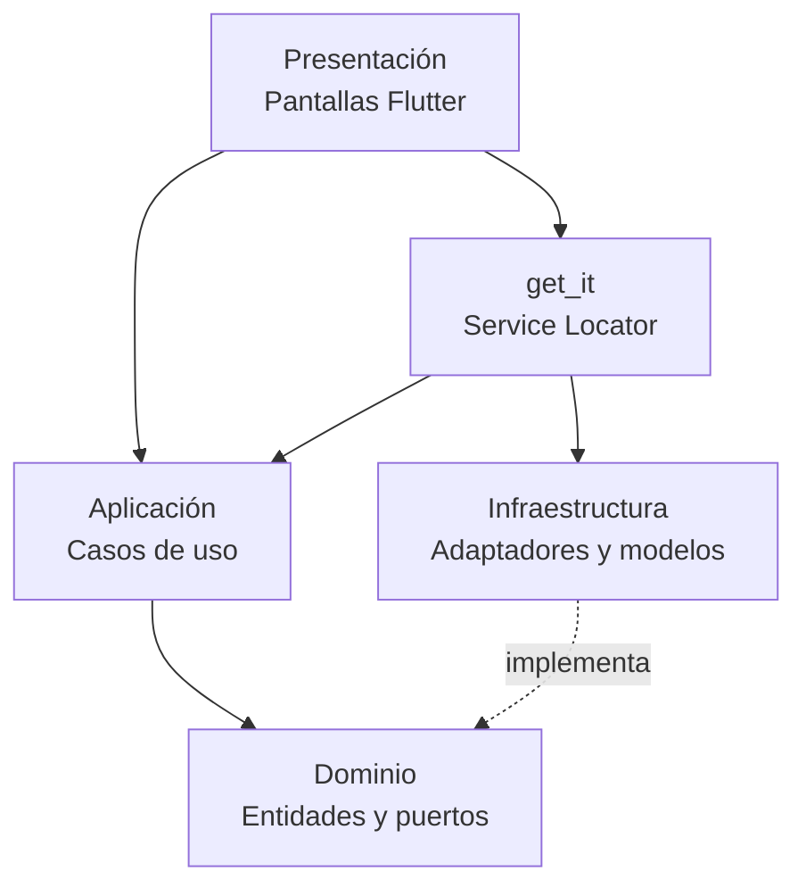

# Arquitectura y Persistencia — TP5

## Objetivo

Documentar la evolución del MVP de **La Nota Barber Shop** hacia una aplicación Flutter con persistencia real, manteniendo la Arquitectura Hexagonal y el desacoplamiento entre dominio, aplicación, infraestructura y presentación.

El TP5 exige:

- Dos adaptadores de persistencia reales y heterogéneos.
- Dominio puro, sin dependencias de frameworks ni anotaciones de base de datos.
- Data Models y mappers bidireccionales.
- Traducción de errores técnicos a excepciones de dominio.
- Dos nuevas Historias de Usuario con casos de uso y pantallas.
- Inyección de dependencias limpia con `get_it`.

---

## Capas y regla de dependencia



- **Dominio:** entidades puras (`Cliente`, `Servicio`, `Turno`, `ConfiguracionAgenda`), puertos e excepciones. No importa Flutter, SQLite ni SharedPreferences.
- **Aplicación:** casos de uso que orquestan operaciones y validan reglas de negocio.
- **Infraestructura:** implementaciones concretas de los puertos, modelos de persistencia y mappers.
- **Presentación:** pantallas Flutter que consumen casos de uso obtenidos desde `get_it`.

La regla de dependencia se mantiene: las capas externas dependen de las internas, nunca al revés.

---

## Persistencia políglota

### 1. SQLite — datos estructurados

Base de datos local: `barberia.db`.

Tablas:

- `turnos`: reservas con datos del cliente, servicio, fecha y hora.
- `servicios`: catálogo con nombre, duración y precio.

Adaptadores:

- `SqfliteTurnoAdapter`
- `SqfliteServicioAdapter`

Ambos usan una **caché en memoria** para resolver las lecturas síncronas que exigen los puertos del dominio. Las escrituras son asíncronas:

1. Se persiste primero en SQLite.
2. Si la operación fue exitosa, se actualiza la caché.
3. Si SQLite falla, no se modifica la caché y se lanza una excepción de dominio.

Esta estrategia evita que la interfaz muestre un éxito falso cuando la escritura real falló.

### 2. SharedPreferences — configuración clave-valor

Adaptador: `SharedPreferencesConfigAdapter`.

Se almacenan:

- Hora de apertura.
- Hora de cierre.
- Duración de bloque en minutos.
- Preferencia de modo oscuro.

Es un almacenamiento liviano, adecuado para configuraciones que no requieren consultas relacionales.

### 3. In-memory — modo simulado

Adaptadores:

- `InMemoryTurnoAdapter`
- `InMemoryServicioAdapter`
- `InMemoryConfiguracionAdapter`

Se usan cuando `initDependencies(useRealStorage: false)` para pruebas o ejecución sin motores nativos.

---

## Modelos y mappers

Las entidades de dominio no conocen la estructura de la base de datos. La traducción se concentra en infraestructura:

- `TurnoModel`
  - `fromSqflite` / `toSqflite`
  - `fromMap` / `toMap`
  - `fromEntity` / `toEntity`
- `ServicioModel`
  - `fromSqflite` / `toSqflite`
  - `fromMap` / `toMap`
  - `fromEntity` / `toEntity`

El flujo es bidireccional:

```text
Entidad de dominio → Model → Fila SQLite
Fila SQLite → Model → Entidad de dominio
```

---

## Disponibilidad horaria

La configuración del local dejó de ser un dato aislado. Ahora se usa para calcular los horarios que se ofrecen en la reserva.

Componentes:

- `DisponibilidadHorariaService` (dominio):
  - Genera bloques entre apertura y cierre usando `duracionBloqueMinutos`.
  - Descarta bloques donde el servicio no entra antes del cierre.
  - Excluye horarios pasados.
  - Detecta superposición con turnos existentes usando la duración real de cada servicio.
- `ObtenerHorariosDisponiblesUseCase`:
  - Lee `ConfiguracionAgenda` y los turnos del día.
  - Devuelve la lista de horarios disponibles.
- `AgendarTurnoUseCase`:
  - Vuelve a validar la disponibilidad antes de persistir, para evitar reservas inválidas aunque la UI falle.

Flujo:

```text
Pantalla de reserva
  → ObtenerHorariosDisponiblesUseCase
  → ConfiguracionRepository + TurnoRepository
  → DisponibilidadHorariaService
  → Lista de horarios disponibles

Confirmar reserva
  → AgendarTurnoUseCase
  → DisponibilidadHorariaService
  → TurnoRepository.save()
```

La misma lógica se usa en el alta manual de turnos del panel administrador.

---

## Manejo de errores

Los adaptadores capturan excepciones técnicas del driver y las traducen a excepciones de dominio:

| Excepción de dominio | Uso |
|---|---|
| `PersistenceFailureException` | Fallo de apertura, lectura o escritura en SQLite. |
| `TurnoNotFoundException` | Turno inexistente al cancelar o eliminar. |
| `ServicioNotFoundException` | Servicio inexistente al actualizar un precio. |
| `ServicioInvalidoException` | Datos inválidos al crear un servicio. |
| `ConfiguracionFailureException` | Fallo de SharedPreferences. |
| `ConfiguracionInvalidaException` | Horarios o duración de bloque incoherentes. |
| `HorarioNoDisponibleException` | Intento de reserva fuera de horario o superpuesto. |

La UI recibe estas excepciones y muestra un mensaje al usuario sin conocer el driver subyacente.

---

## Inyección de dependencias

`lib/injection_container.dart` centraliza el registro con `get_it`.

```dart
await initDependencies(useRealStorage: true);
```

- `useRealStorage: true` registra SQLite y SharedPreferences.
- `useRealStorage: false` registra adaptadores en memoria.

Los casos de uso reciben únicamente los puertos del dominio, por lo que no conocen el mecanismo de persistencia activo.

---

## Nuevas Historias de Usuario

### HU 7 — Configuración de la agenda local

- Caso de uso: `ConfigurarAgendaUseCase`
- Pantalla: `ConfiguracionAgendaScreen`
- Persistencia: `SharedPreferencesConfigAdapter`
- Entidad: `ConfiguracionAgenda`

### HU 8 — Historial de cliente por teléfono

- Caso de uso: `ObtenerHistorialClienteUseCase`
- Pantalla: `HistorialClienteScreen`
- Persistencia: `SqfliteTurnoAdapter`
- Consulta: `findByClienteTelefono`

El detalle completo con criterios de aceptación está en [HU del TP5](hu_tp5.md).

### Flujos adicionales implementados

Además de las HU 7 y HU 8, la interfaz cubre:

- Reserva autónoma del cliente: selección de servicio, fecha, horario disponible y confirmación.
- Agenda del administrador con navegación lateral, fechas rápidas, cancelación y alta manual.
- Catálogo de servicios con alta y edición de precios.
- Configuración y historial accesibles desde el panel.

La aplicación abre en la reserva del cliente. El panel administrador se abre desde el ícono de administración de la cabecera.

---

## Decisiones técnicas

1. **Fechas y horas como texto**
   - Se mantiene el formato `YYYY-MM-DD` y `HH:MM` para evitar problemas de zonas horarias y simplificar la persistencia.

2. **Lecturas síncronas desde caché**
   - Los puertos conservan lecturas síncronas para que la UI no dependa de `Future` en cada consulta.
   - La caché se hidrata desde SQLite al iniciar la aplicación.

3. **Escrituras asíncronas**
   - `save` y `delete` devuelven `Future<void>` para poder esperar la persistencia real y propagar errores.

4. **Servicios persistidos en SQLite**
   - El catálogo y los precios ya no se pierden al reiniciar.
   - Se agregó la tabla `servicios` con datos iniciales.

5. **Migración de base de datos**
   - La versión del esquema pasó a `2`.
   - `onUpgrade` crea la tabla `servicios` si la base existente era de la versión 1.

6. **Disponibilidad como regla de dominio**
   - El cálculo de horarios vive en `DisponibilidadHorariaService`, no en la UI.
   - La reserva se valida dos veces: al mostrar horarios y al confirmar.

7. **Interfaz monocromática**
   - Se usa una paleta de blancos, negros y un azul noche (`#011627`) como superficie oscura secundaria.
   - El estilo sigue los wireframes: tarjetas, botones negros, secciones en mayúscula y navegación lateral en el panel.

---

## Estructura relevante

```text
lib/
├── domain/
│   ├── entities/
│   │   ├── cliente.dart
│   │   ├── configuracion_agenda.dart
│   │   ├── servicio.dart
│   │   └── turno.dart
│   ├── exceptions/
│   ├── ports/
│   └── services/
│       └── disponibilidad_horaria_service.dart
├── application/
│   └── use_cases/
├── infrastructure/
│   ├── adapters/
│   ├── database/
│   │   └── barberia_database.dart
│   └── models/
├── presentation/
│   ├── screens/
│   ├── theme/
│   ├── utils/
│   ├── widgets/
│   └── app_routes.dart
├── injection_container.dart
└── main.dart
```

---

## Limitaciones actuales

- El modelo `Turno` no tiene estado (`Reservado`, `Cancelado`); la cancelación elimina el registro.
- No hay autenticación: el panel administrador se abre directamente desde la pantalla pública.
- No se implementaron bloqueos excepcionales por día/hora ni horario de almuerzo.
- No existe todavía la galería de cortes ni la cancelación autónoma del cliente.
- No hay recordatorios automáticos.
- La persistencia real con `sqflite` está pensada para Android/iOS. Para escritorio o pruebas de integración se usa `sqflite_common_ffi`.
