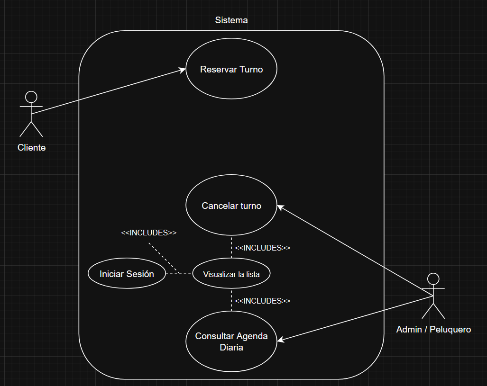

# Casos de Uso

## Casos de uso implementados

El sistema cuenta actualmente con los siguientes casos de uso de aplicación:

1. `AgendarTurnoUseCase`
2. `ObtenerTurnosPorDiaUseCase`
3. `CancelarTurnoUseCase`
4. `ActualizarPrecioServicioUseCase`
5. `ObtenerCatalogoServiciosUseCase`
6. `ValidarDisponibilidadHorariaUseCase`
7. `ConfigurarAgendaUseCase` — HU 7
8. `ObtenerHistorialClienteUseCase` — HU 8

Las HU 7 y HU 8 se detallan en [hu_tp5.md](hu_tp5.md).
