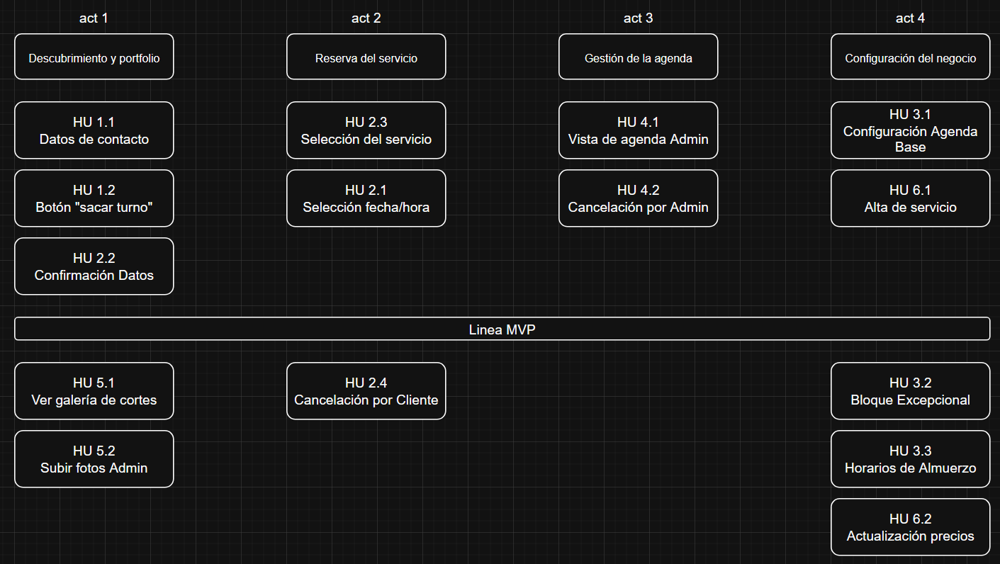

# Mapa de Historias de Usuario

## Extensión del TP5

El mapa anterior corresponde al MVP original. El TP5 incorpora dos Historias de Usuario adicionales, ubicadas por fuera de la línea del MVP inicial:

- **HU 7:** Configuración de la agenda local.
- **HU 8:** Historial de cliente por teléfono.

El detalle de ambas historias y sus criterios de aceptación está en [HU del TP5](hu_tp5.md).

## Flujos del MVP cubiertos por la interfaz

- Reserva del cliente con selección de servicio, fecha, horario y datos.
- Agenda diaria del administrador con cancelación.
- Configuración de disponibilidad y uso de esa configuración para calcular horarios.
- Catálogo de servicios con alta y edición de precios.
- Historial de cliente por teléfono.
